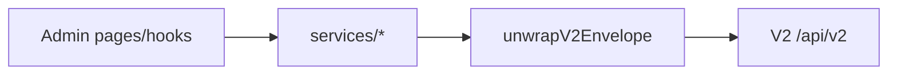

# Align Admin App to CricPR V2 API

## Source of truth

Use the live V2 routes/schemas in [`d:\Codefied\cricpr-v2`](d:\Codefied\cricpr-v2), especially:

- [`docs/to-frontend/flutter_admin_api_reference.md`](d:\Codefied\cricpr-v2\docs\to-frontend\flutter_admin_api_reference.md)
- [`src/modules/admin/routes.ts`](d:\Codefied\cricpr-v2\src\modules\admin\routes.ts) + [`dashboard.service.ts`](d:\Codefied\cricpr-v2\src\modules\admin\dashboard.service.ts)
- [`src/modules/auth/routes.ts`](d:\Codefied\cricpr-v2\src\modules\auth\routes.ts)
- Envelope: [`src/common/response.ts`](d:\Codefied\cricpr-v2\src\common\response.ts)

**Scope default:** remount existing admin pages only (no new Users/ops screens). New V2-only admin surfaces can follow later.

## Critical mismatches to fix

| Area | Admin app today | V2 truth |
|------|-----------------|----------|
| Base URL default | `http://localhost:3002/v1` in [`api.ts`](d:\Codefied\cricpr-v2-admin-app\src\services\api.ts) | `.env.example` already `…/api/v2`; align fallback |
| Response body | Treats Axios `response.data` as domain payload | Envelope `{ ok, status, message, data, pagination? }` — unwrap `data` (+ `pagination`) |
| Login | `POST /auth/adminLogin` | `POST /auth/admin/login` → `{ email, password }` → `data: { user, tokens }` |
| Logout | `POST /admin/logout` | `POST /auth/logout` (Bearer + optional `refreshToken`) |
| Refresh | Exists but unused; returns wrong shape | `POST /auth/refresh` → `data: { user, tokens }` (full pair) |
| User photo field | `profilePhoto` | `profilePicture` |
| Profile photo update | `PATCH …/edit-profilePhoto` with FormData | Upload `POST /contents/upload` (`type=profilePicture`) and/or `PATCH /admin/edit-profilePhoto` with `{ profilePicture: url }` |
| Password change | `POST /admin/vp`, `PATCH /admin/cp` | **Not registered** — remove from Profile UI |
| Dashboard numbers | Nested `matches.total`, etc. | Flat: `totalMatches`, `matchesMonthChangePct`, `totalTournaments`, `activeTournaments`, `totalTeams`, `totalPlayers`, `playersLast30Days` |
| Lists | `results` / Mongo `_id` shapes | Envelope `data[]` + `pagination`; UUID models (`id`, nested `user`, etc.) |
| Player delete | `DELETE /admin/players/:id` | `DELETE /players/:id` (Bearer) |
| Recent matches | Custom DTO + `matchesOverTime` | Raw Match rows + teams/config; **no** `matchesOverTime` |
| Stats | Leaderboards + extras | Totals + `statsByBallType` / optional `?ballType=`; leaderboards come from `/admin/topRunsAndWickets` |
| Ads | `{ showAndroidAds, showIOSAds }` via `POST /admin/ads/status` | `GET /admin/ads/status` → `{ [platform]: { status, … } }`; update via `PATCH /admin/ad-config/:platform` with `{ status }` (`android` / `ios`) |
| Notifications list | `GET /admin/notifications` | **Does not exist** — keep **send** via `POST /admin/notifications/send` `{ title, body, userIds?: uuid[] }`; drop fake history or show `GET /notifications` inbox only if useful |

## Implementation plan

### 1. Shared API client + envelope

Update [`src/services/api.ts`](d:\Codefied\cricpr-v2-admin-app\src\services\api.ts):

- Default `baseURL` to `http://localhost:4001/api/v2` (match `.env.example`).
- Add typed `V2Envelope<T>` and helpers:
  - `unwrapData(response)` → `response.data.data`
  - `unwrapList(response)` → `{ data, pagination }` from envelope root
  - Error parsing: prefer envelope `message` / `error` when present
- Keep Bearer interceptor; optionally attempt refresh once on 401 using stored refresh token before logout (wire existing `authApi.refreshToken`).

### 2. Auth service + store

Update [`authApi.ts`](d:\Codefied\cricpr-v2-admin-app\src\services\authApi.ts), [`useAuth.ts`](d:\Codefied\cricpr-v2-admin-app\src\hooks\useAuth.ts), [`useAuthStore.ts`](d:\Codefied\cricpr-v2-admin-app\src\store\useAuthStore.ts):

- Paths: `/auth/admin/login`, `/auth/refresh`, `/auth/logout`
- Types: roles as `{ id, name }[]`; map `profilePicture` into store (keep UI alias if needed)
- `editName`: `PATCH /admin/edit-name` `{ name }`
- Photo: `POST /contents/upload` multipart (`file` + `type=profilePicture`); refresh local user from response / profile
- Remove `verifyPassword` / `changePassword` API methods; strip password UI from [`Profile.tsx`](d:\Codefied\cricpr-v2-admin-app\src\pages\profile\Profile.tsx)

### 3. Dashboard + stats services and pages

Rewrite types/calls in [`dashboardApi.ts`](d:\Codefied\cricpr-v2-admin-app\src\services\dashboardApi.ts) and consumers under [`pages/dashboard/`](d:\Codefied\cricpr-v2-admin-app\src\pages\dashboard):

- Paths stay under `/admin/*` but unwrap envelope and map flat number fields in `DashboardStats`
- `topTalent` / `topRunsAndWickets`: accept optional `ballType`; map nested `player.user.name`, `totalRuns` / `totalWickets`
- `recentMatches`: map Match model → table rows; for `MatchesOverTimeChart`, **derive** monthly buckets client-side from `startDatetime` (API no longer returns `matchesOverTime`)
- `recentSignups`: map User rows (`name`, `profilePicture`, `email`, `city`, `createdAt`)

Rewrite [`statsApi.ts`](d:\Codefied\cricpr-v2-admin-app\src\services\statsApi.ts) + [`Stats.tsx`](d:\Codefied\cricpr-v2-admin-app\src\pages\stats\Stats.tsx):

- Show `totalRuns` / `totalWickets` / `totalFours` / `totalSixes` / `completedMatches` with `ballType` selector
- Use `topRunsAndWickets` (or dashboard hook) for leaderboard tables instead of obsolete stats leaderboard fields

### 4. Entity list/detail/delete services + pages

Update [`playersApi`](d:\Codefied\cricpr-v2-admin-app\src\services\playersApi.ts), [`playerApi`](d:\Codefied\cricpr-v2-admin-app\src\services\playerApi.ts), [`teamsApi`](d:\Codefied\cricpr-v2-admin-app\src\services\teamsApi.ts), [`matchesApi`](d:\Codefied\cricpr-v2-admin-app\src\services\matchesApi.ts), [`tournamentsApi`](d:\Codefied\cricpr-v2-admin-app\src\services\tournamentsApi.ts) and their list/detail pages:

- List: `data` + `pagination` (`total`, `page`, `limit`, `totalPages`)
- Player list fields from Player + nested `user` (name/city/photo)
- Detail: match V2 payloads (`player` + `statsByBallType` / batting-bowling; team with `players`; match with `teamA`/`teamB`/`config`/`innings`; tournament with `teams`/`stages`)
- Deletes: teams/matches/tournaments keep `/admin/.../:id`; players → `DELETE /players/:id`
- Drop Mongo-style `_id` / `__v` types

### 5. Ads + notifications

- [`adsApi.ts`](d:\Codefied\cricpr-v2-admin-app\src\services\adsApi.ts) + [`AddManager.tsx`](d:\Codefied\cricpr-v2-admin-app\src\pages\add-manager\AddManager.tsx): read platform map; toggle via `PATCH /admin/ad-config/android|ios` with `{ status: 'active' | 'inactive' }`; rename copy to Ads (route can stay `/add-manager` to avoid router churn, or rename in sidebar)
- [`notificationsApi.ts`](d:\Codefied\cricpr-v2-admin-app\src\services\notificationsApi.ts) + page: only `POST /admin/notifications/send` with `{ title, body, userIds? }` (real **user** UUIDs — for “selected players”, resolve `player.userId` / nested `user.id`); remove broken `GET /admin/notifications` history

### 6. Verify against running API

With `pnpm dev` + V2 on `:4001`, smoke: login → dashboard cards → one list/detail/delete path → ads toggle → notification send → profile name/photo.

## Out of scope (this pass)

- New Users management UI (`GET /admin/users`)
- Player verify, request/webhook logs, cache warmup
- Backend fixes (e.g. broken `POST /admin/ads/status` without `:platform` — client will use `PATCH /admin/ad-config/:platform` instead)
